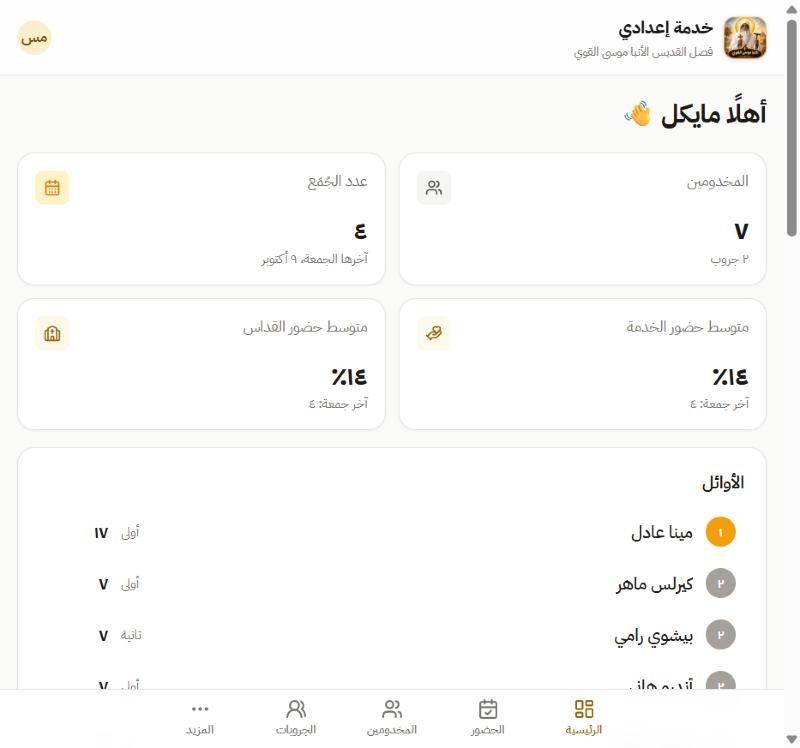
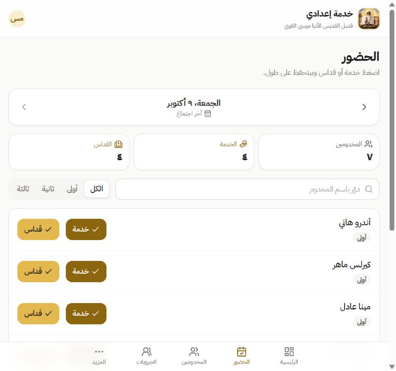
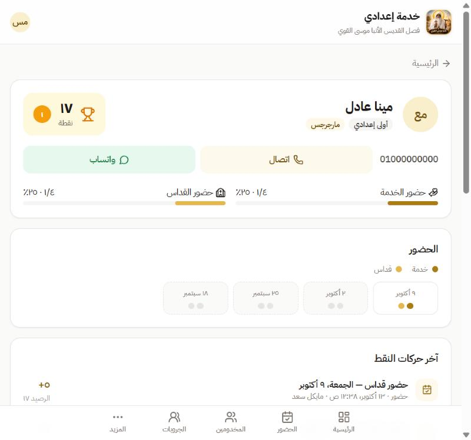

<p align="center">
  
</p>

<h1 align="center">Khedma E3dady</h1>

<p align="center">
  Attendance and points tracking for a church middle-school (إعدادي) service.<br />
  Mobile-first, Arabic (RTL) web app with a Spring Boot API.
</p>

---

Every Friday, servants mark who attended **service** and **mass**. The app saves each tap instantly
and awards points automatically, so the points table is always up to date and kids can see their rank.

<p align="center">
  
  
  
</p>

## Features

- **One-tap attendance**: toggle service / mass per student; each change saves immediately.
- **Automatic points**: marking attendance awards points (configurable per kind), and unmarking reverses
  exactly what was awarded. Nothing is ever double-counted.
- **Skip a Friday**: mark a meeting as not held; its points are reversed and it's excluded from all stats,
  and you can restore it later.
- **Points ledger**: every change (automatic or manual add / deduct / reset) is an immutable transaction with
  a reason, author and running balance. Frequent reasons can be saved and picked in one tap.
- **Groups**: teams with their own manually managed points and a leaderboard.
- **Dashboard**: season stats, ranked student cards, attendance history, and call / WhatsApp buttons.
- **Accounts & roles**: email + password with a 6-digit email code (verification and password reset), or
  Google sign-in. New accounts wait for approval; roles are `USER`, `ADMIN` and `SUPER_ADMIN`.

## Tech stack

| Part     | Technology                                                    |
| -------- | ------------------------------------------------------------- |
| Web app  | React 19, Vite, TypeScript, Tailwind CSS 4, TanStack Query    |
| API      | Spring Boot 3.5 (Java 17), Spring Security, JWT, JPA          |
| Database | PostgreSQL 16 with Flyway migrations                          |
| Email    | Brevo HTTPS API (or any SMTP server)                          |
| Tests    | JUnit 5 + Testcontainers (real PostgreSQL)                    |

## Project structure

```
├── backend/              Spring Boot API
│   └── src/main/java/com/khedma/
│       ├── attendance/   meetings, attendance, skipping a meeting
│       ├── points/       ledger, manual transactions, saved reasons
│       ├── dashboard/    statistics and student cards
│       ├── auth/         login, Google, email codes, JWT
│       └── …             students, groups, users, settings
├── frontend/             React app (all UI text lives in src/lib/copy.ts)
└── docker-compose.yml    local PostgreSQL
```

## How points work

Points live in a single ledger table; balances on students and groups are a cached sum of it.

- Saving attendance reconciles each kind (service, mass) with the ledger:
  marked and not yet awarded → **award**; unmarked → **reverse** the earlier award.
- Reversals always cancel the amount originally awarded, even if the settings changed since.
- Meetings before the configured *points start date* never award points, which keeps imported history
  point-free.
- Skipping a meeting reverses its awards; restoring it re-awards them.

## Getting started

**Prerequisites:** Java 17+, Maven, Docker, Node 20+, pnpm.

```bash
# 1. Start PostgreSQL on port 5433
docker compose up -d

# 2. Run the API on port 8080
cd backend
mvn spring-boot:run
```

In a second terminal:

```bash
cd frontend
cp .env.example .env.local
pnpm install
pnpm dev            # http://localhost:3000
```

Without email settings, verification codes are printed in the API log, so you can sign up locally.
Add your email to `SUPER_ADMIN_EMAILS` to get full access after verifying it.

Run the tests (Docker must be running):

```bash
cd backend
mvn test
```

## Configuration

API settings come from environment variables. See [`backend/.env.example`](backend/.env.example).

| Variable               | Description                                                       |
| ---------------------- | ----------------------------------------------------------------- |
| `DB_URL`, `DB_USERNAME`, `DB_PASSWORD` | PostgreSQL connection (JDBC URL)                  |
| `JWT_SECRET`           | Token signing key, at least 32 characters                         |
| `SUPER_ADMIN_EMAILS`   | Comma-separated emails promoted to `SUPER_ADMIN` once verified    |
| `CORS_ALLOWED_ORIGINS` | Web app origin(s)                                                 |
| `GOOGLE_CLIENT_ID`     | Optional, enables Google sign-in                                  |
| `MAIL_FROM`, `BREVO_API_KEY` | Sender and Brevo key for the code emails                    |
| `SPRING_MAIL_*`        | Plain SMTP instead of Brevo                                       |

The web app reads `VITE_API_URL` and the optional `VITE_GOOGLE_CLIENT_ID`
(see [`frontend/.env.example`](frontend/.env.example)).

## Deployment

The app runs on free tiers:

| Part     | Host                                   | Notes                                               |
| -------- | -------------------------------------- | --------------------------------------------------- |
| Database | [Neon](https://neon.tech)              | Use the direct (non-pooled) connection for Flyway   |
| API      | [Render](https://render.com)           | Docker web service, root directory `backend`, health check `/api/health` |
| Web app  | [Vercel](https://vercel.com)           | Root directory `frontend` (SPA rewrites in `vercel.json`) |
| Email    | [Brevo](https://www.brevo.com)         | HTTPS API, since many free hosts block SMTP ports |

Render's free plan sleeps after 15 minutes without traffic; an uptime monitor hitting `/api/health`
keeps it awake.

## API overview

All endpoints are under `/api` and require a `Bearer` token except `/auth/*` and `/health`.
Errors return a stable `code` (see [`ErrorCode.java`](backend/src/main/java/com/khedma/common/ErrorCode.java))
that the web app translates to Arabic.

| Area        | Endpoints                                                                       | Role          |
| ----------- | ------------------------------------------------------------------------------- | ------------- |
| Auth        | `/auth/register`, `/verify-email`, `/resend-code`, `/login`, `/google`, `/forgot-password`, `/reset-password` | Public |
| Account     | `GET /me`                                                                       | Signed in     |
| Dashboard   | `GET /dashboard`, `/dashboard/students`, `/dashboard/students/{id}`             | Approved user |
| Attendance  | `GET /attendance/meetings`, `GET /attendance/{date}`, `PUT /attendance/{date}/students/{id}`, `PUT`/`DELETE /attendance/{date}/skip` | Admin |
| Students    | `GET`/`POST /students`, `PUT`/`DELETE /students/{id}`                            | Admin         |
| Groups      | `GET`/`POST /groups`, `PUT /groups/{id}`                                         | Admin         |
| Points      | `POST /students/{id}/points`, `POST /groups/{id}/points`, `GET /transactions`, `/point-reasons` | Admin |
| Settings    | `GET`/`PUT /settings`                                                            | Admin         |
| Users       | `GET /users`, `PATCH /users/{id}`, `PUT /users/{id}/student`                     | Super admin   |

---

<p align="center">
  Made for the Saint Moses the Strong (القديس الأنبا موسى القوي) class.
</p>
